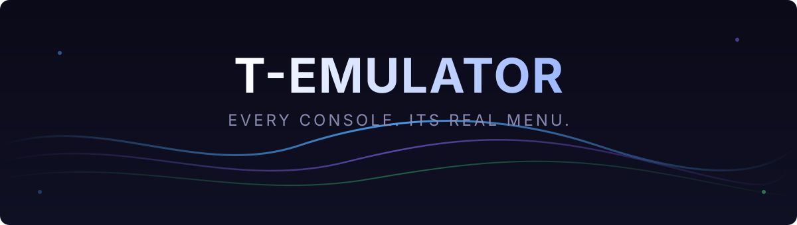

<div align="center">



<br>


<br>

**Power on a console. Get its real menu. Play.**
*The emulators handle themselves in the basement where they belong.*

</div>

---

## 🌊 The idea

Nobody makes menus like consoles did. The PSP's drifting wave. The GameCube's spinning cube. The PS3's glowing crossbar.

**T-Emulator brings them back** — not as screenshots, but as the real interface you navigate. Pick a console, its menu takes over your screen, your games live inside it.

The emulator doing the work? You never see its window, its settings, or its name.

## 🎮 What it does

|  |  |
|---|---|
| **🕹️ Real console menus** | XMB, GameCube menu, dashboards — fullscreen, faithful, yours to browse |
| **📦 Zero setup** | Emulators download, update, and configure themselves |
| **📚 One library** | Every game across every system, scanned and covered |
| **🎛️ One controller** | Mapped once, works everywhere, couch-first navigation |
| **🔧 One settings hub** | Never open an emulator's config screen again |

## 🚀 The journey

```
v0.1   PSP  + XMB wave           ◄━━━ building now
v0.3   PS3  + firmware wizard      (MGS4 lives here)
v0.4   GC/Wii + system menu
v0.5   PS2 · PS1 · Xbox 360
later  PS5 · Switch 2 · saves · achievements · homebrew store
```

## ⚖️ The one rule

**Your games, your dumps.** T-Emulator never downloads commercial games, and never will. The built-in store is homebrew and freeware only.

## 📖 Docs

[Master Plan](PLAN.md) · [UI Spec](UI_SPEC.md) · [v0.1 Build Plan](V0.1_PLAN.md)

---

<div align="center">
<sub>Built with Rust + Slint · native UI, zero webview</sub>
<br>
<sub>⭐ Star to follow the build</sub>
</div>
